import transform from './assets/transform.webm';
import { Image } from 'astro:assets';
import b1 from './assets/b1.jpg';
import b2 from './assets/b2.jpg';
import b3 from './assets/b3.jpg';
import b4 from './assets/b4.jpg';
import b5 from './assets/b5.jpg';
import b6 from './assets/b6.jpg';
import b7 from './assets/b7.jpg';
import b8 from './assets/b8.jpg';
import b9 from './assets/b9.jpg';
import b10 from './assets/b10.jpg';
import b11 from './assets/b11.jpg';
import b12 from './assets/b12.jpg';
import b13 from './assets/b13.jpg';
import b14 from './assets/b14.jpg';
import b15 from './assets/b15.jpg';
import b16 from './assets/b16.jpg';
import b17 from './assets/b17.jpg';
import b18 from './assets/b18.jpg';

This page covers how to manage layers, how to change the way they combine with each other, and how to hide parts of them with masks. 

:::note
Aligning Multiple Layers and Layer Locking were added in PixiEditor 2.2, which is currently available in the development channel. To switch to it, go to `Edit → Settings → Updates` and change the channel to Development.
:::

## Layer Management

Most work around the layers is done from the layers panel, which is located in the middle of the right side of the app. 

:::note
In PixiEditor every layer is separate a node in the Node Graph and many advanced rendering behaviours can be customized there. To read more about nodes, go to [this page.](https://pixieditor.net/docs/handbook/node-graph/getting-started-with-node-graph/)
:::

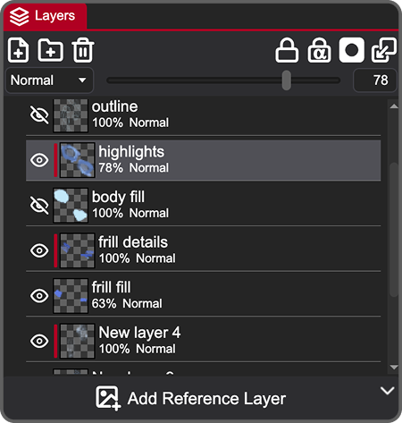

### Layer List

The main part of the Layer Panel is a list of layers:

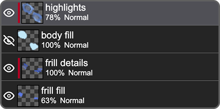

The active layer or folder has a lighter background. To select more than one layer, hold `Ctrl` / `⌃`  or `Shift` while clicking. The additionally selected layers have a slightly different highlight, and you can apply actions like deleting, merging and aligning to all of them at once.

Each layer has an eye icon <span className="pixi-icon icon-eye"/> / <span className="pixi-icon icon-eye-off"/> to toggle its visibility in the composition. Next to it is a thumbnail preview of the layer content, followed by its name, opacity percentage and a blend mode.

To rename a layer, double-click its name to enter text-editing mode and type your new title. There is also a `Rename` option in the right-click menu.

### Reordering

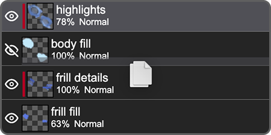

To change the order of your layers, drag and drop them in the layers panel. Drop a layer onto a folder to move it inside. While dragging you will see a highlight indicating where the layer will be placed.

### Basic Actions


You can do these basic actions from a bar at the top of the layers panel:

-  <span className="pixi-icon icon-file-plus"/> - Create new layer (`Shift + Ctrl + N` / `⇧ + ⌘ + N`)
-  <span className="pixi-icon icon-folder-plus"/> - Create new folder
-  <span className="pixi-icon icon-trash"/> - Delete all selected layers and folders (you can undo this action)

### Layer Types

PixiEditor has several kinds of layers, and they don't all behave the same way. Some actions on this page only work with certain types.

- **Raster Layer:** A layer made of pixels. This is the type you draw on with brushes, the pencil, the eraser and the bucket fill.
- **Vector Path:** You can create it with the Vector Pen tool or by converting a shape into curves.
- **Vector Shapes:** Shapes that stay editable, so you can change their size, position and style later. They are created with the shape tools:
  - **Rectangle**
  - **Ellipse**
  - **Line**
  - **Text** 
- **Folder:** Groups other layers. You can reorder them, and also give the folder a blend mode, a mask or a clip.
- **Smart Layer:** A layer that you can open as a separate file and modify outside the original layer tree. It can also be linked to a file on your disk. 


### Transformations

To select a layer, click it in the layers panel.

You can also select a layer directly from the canvas. Choose the Move tool (```V```) and click the object you want to move. You don't need selection tools like the magic wand or the lasso to move something.

:::note
How a layer is transformed depends on its type. Raster layers are made of pixels, so moving or transforming one moves and resamples those pixels, and the result can look slightly different from the original. Other layer types, such as vector shapes, text and smart layers, only change the position of the object that is rendered, so they stay as sharp as before.
:::

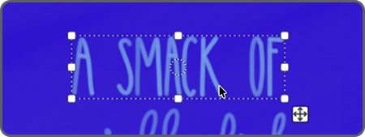

With the Move tool (`V`) active, the selected layer gets transform handles around it. 

here are many ways to transform a layer:

- **Scale:** Drag a handle.
- **Scale from the center:** Hold `Ctrl` / `⌃` and drag a handle.
- **Scale proportionally:** Hold `Shift` while dragging a handle.
- **Free transform:** Hold `Alt` / `⌥` and drag a side handle. (works only for raster layers)
- **Shear:** Drag outside a side handle.
- **Rotate:** Drag outside the corner handles. By default, the layer rotates around the circle in its center. Drag the circle to rotate around a different point.

If you prefer to see it on video:

<video src={transform} muted autoplay loop/>

#### Aligning Multiple Layers

*Available in version 2.2 and newer.*

When you select multiple layers, a bar appears on the canvas.

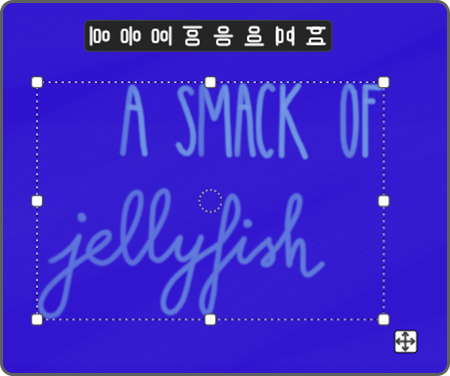

Options in this bar are as follows:

-  <span className="pixi-icon icon-align-horizontal-justify-start"/> - Align to the left side of the selection
-  <span className="pixi-icon icon-align-horizontal-justify-center"/> - Align horizontal centers
-  <span className="pixi-icon icon-align-horizontal-justify-end"/> - Align to the right side of the selection
-  <span className="pixi-icon icon-align-vertical-justify-start"/> - Align to the top of the selection
-  <span className="pixi-icon icon-align-vertical-justify-center"/> - Align vertical centers
-  <span className="pixi-icon icon-align-vertical-justify-end"/> - Align to the bottom of the selection
-  <span className="pixi-icon icon-align-horizontal-space-between"/> - Distribute horizontal spacing (min 3 layers)
-  <span className="pixi-icon icon-align-vertical-space-between"/> - Distribute vertical spacing (min 3 layers)


### Locking

Locking protects a layer from unwanted changes.

#### Lock Layer

*Available in version 2.2 and newer.*


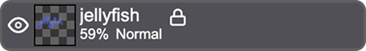

Locks everything on the layer. Nothing can be changed until you unlock it.

#### Lock Transparency


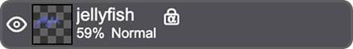

Protects the transparency of the layer. When you paint, the pixels keep their original transparency value: transparent pixels stay transparent, and semi-transparent pixels stay equally semi-transparent, while their color changes.

Lock Transparency works only on raster layers. It's disabled for vector and smart layers.

### Clipping

Clipping limits a layer to the shape of the layer below it. Anything of the clipped layer that goes outside that shape is hidden, but not erased.

To clip a layer, right click on it in the Layer List and choose `Clip to Member Below`.

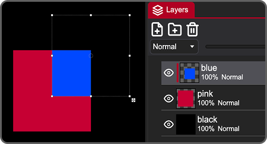

Clipping works with folders too. You can clip several layers in a row.

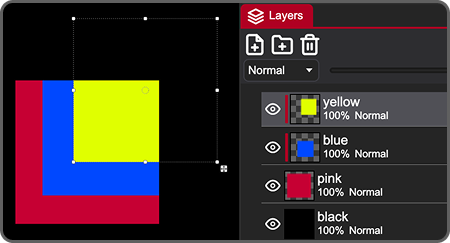

### Merging Layers

Merging combines layers into one. There are three options in the right-click menu in the layer list:

- `Merge Selected` - Merges all selected layers into a single layer.
- `Merge Selected Layer With Above` - Merges the selected layer into the one above it.
- `Merge Selected Layer With Below` - Merges the selected layer into the one below it. This action is also available in the top bar of the layers panel.


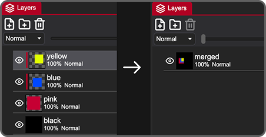

What you get after merging depends on the types of the layers:

A blend mode is a mathematical formula that defines how pixels of two layers combine. In PixiEditor, the blend mode of a layer decides how that layer is combined with the layers below it.

| Input | Output | Is it reversible? |
| ------- | ------ | -------------------------- |
| Raster + raster | One raster layer | The pixels are combined and can't be separated again. |
| Vector + vector | One vector layer containing all the shapes | The shapes stay editable, and you can split them again with `Separate Shapes`. |
| Raster + vector | One raster layer | The vector layer is rasterized first, so its shapes can't be edited anymore. |
| Smart layer + any other layer | One raster layer | The smart layer is rasterized, so it no longer links to its embedded file. |

Raster layers store pixels, so merged pixels can't be separated again. Vector layers store shape data, and merging only combines that data into one layer, so `Separate Shapes` can split it apart again.

### Converting Layers

When you right-click a layer in the layer list, you'll find 4 actions specific to vector and smart layers at the bottom of the menu:

- `Rasterize` converts a layer to pixels. After rasterizing, you can paint on the layer, but you can no longer edit its shapes or open it as a smart layer.

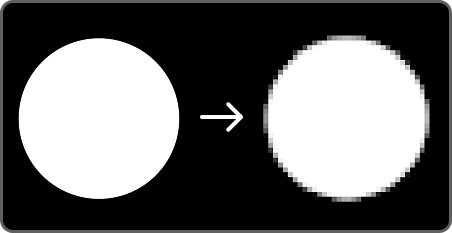

- `Convert to Curve` converts a vector shape or text to curves. You can then use the pen tool <span className="pixi-icon icon-vector-pen"/> to adjust the path.

- `Separate Shapes` separates two or more vector shapes merged together.

- `To Smart Layer` works with every type of layer. It turns the layer into a nested file that you can modify outside the original layer tree. 
You can also use smart layers to embed another file in your document. It allows to use the same file several times in one document, for example the same tree repeated across a landscape.

- `Reset Transform` brings back the default look of a vector or smart layer.

## Blend Modes & Opacity

A blend mode is a mathematical formula that defines how pixels of two layers blend with each other. In PixiEditor, it works in top-to-bottom order, the top layer with a blend mode changes how that layer renders blending with the layer below. The bottom layer is not affected by the layer above.

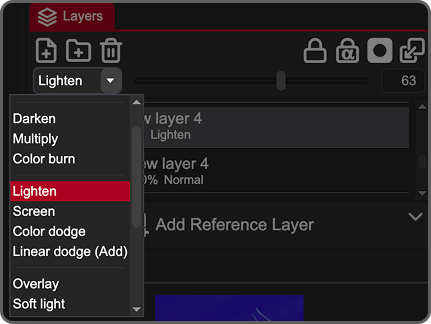

Blend modes work on folders as well, so you can change how a whole group of layers combines with the rest of the image.

:::tip
Blend mode and opacity work together. The blend mode decides how colors combine, and opacity decides how strongly the result shows.
:::

### Available Blend Modes

**Basic**
- `Normal` - The layer covers what's below it.
  <Image src={b1} style={{ width: '200px', height: 'auto' }} alt="An eagle with a yellow rectangle layer using the Normal blend mode" />

- `Erase` - Removes pixels from the layers below. Takes in the opacity value.
  <Image src={b2} style={{ width: '200px', height: 'auto' }} alt="An eagle with a yellow rectangle layer using the Erase blend mode" />

**Darken**
- `Darken` - Keeps the darker color of the two layers at each pixel.
  <Image src={b3} style={{ width: '200px', height: 'auto' }} alt="An eagle with a yellow rectangle layer using the Darken blend mode" />

- `Multiply` - Multiplies the colors, which always gives a darker result. White has no effect.
  <Image src={b4} style={{ width: '200px', height: 'auto' }} alt="An eagle with a yellow rectangle layer using the Multiply blend mode" />

- `Color Burn` - Darkens the layers below and increases contrast.
  <Image src={b5} style={{ width: '200px', height: 'auto' }} alt="An eagle with a yellow rectangle layer using the Color Burn blend mode" />

**Lighten**
- `Lighten` - Keeps the lighter color of the two layers at each pixel.
  <Image src={b6} style={{ width: '200px', height: 'auto' }} alt="An eagle with a yellow rectangle layer using the Lighten blend mode" />

- `Screen` - The opposite of Multiply: it always gives a lighter result. Black has no effect. A good choice for glows and light effects.
  <Image src={b7} style={{ width: '200px', height: 'auto' }} alt="An eagle with a yellow rectangle layer using the Screen blend mode" />

- `Color Dodge` - Brightens the layers below and reduces contrast.
  <Image src={b8} style={{ width: '200px', height: 'auto' }} alt="An eagle with a yellow rectangle layer using the Color Dodge blend mode" />

- `Linear Dodge (Add)` - Adds the colors together, which makes the result brighter, and quickly reaches pure white.
  <Image src={b9} style={{ width: '200px', height: 'auto' }} alt="An eagle with a yellow rectangle layer using the Linear Dodge (Add) blend mode" />

**Contrast**
- `Overlay` - Multiplies dark areas and screens light areas, so darks get darker and lights get lighter.
  <Image src={b10} style={{ width: '200px', height: 'auto' }} alt="An eagle with a yellow rectangle layer using the Overlay blend mode" />

- `Soft Light` - A gentler version of Overlay.
  <Image src={b11} style={{ width: '200px', height: 'auto' }} alt="An eagle with a yellow rectangle layer using the Soft Light blend mode" />

- `Hard Light` - A stronger version of Overlay.
  <Image src={b12} style={{ width: '200px', height: 'auto' }} alt="An eagle with a yellow rectangle layer using the Hard Light blend mode" />

**Comparison**
- `Difference` - Subtracts the colors of one layer from the other.
  <Image src={b13} style={{ width: '200px', height: 'auto' }} alt="An eagle with a yellow rectangle layer using the Difference blend mode" />

- `Exclusion` - Similar to Difference, but with lower contrast.
  <Image src={b14} style={{ width: '200px', height: 'auto' }} alt="An eagle with a yellow rectangle layer using the Exclusion blend mode" />

**Color**
- `Hue` - Applies the hue of the layer to the layers below and keeps their saturation and luminosity.
  <Image src={b15} style={{ width: '200px', height: 'auto' }} alt="An eagle with a yellow rectangle layer using the Hue blend mode" />

- `Saturation` - Applies the saturation of the layer to the layers below and keeps their hue and luminosity.
  <Image src={b16} style={{ width: '200px', height: 'auto' }} alt="An eagle with a yellow rectangle layer using the Saturation blend mode" />

- `Luminosity` - Applies the luminosity of the layer to the layers below and keeps their hue and saturation.
  <Image src={b17} style={{ width: '200px', height: 'auto' }} alt="An eagle with a yellow rectangle layer using the Color blend mode" />

- `Color` - Applies both the hue and the saturation of the layer to the layers below and keeps their luminosity.
  <Image src={b18} style={{ width: '200px', height: 'auto' }} alt="An eagle with a yellow rectangle layer using the Luminosity blend mode" />

## Masking

A mask hides parts of a layer without erasing them. You can change the mask at any time, so it's a non-destructive way to hide parts of your artwork.

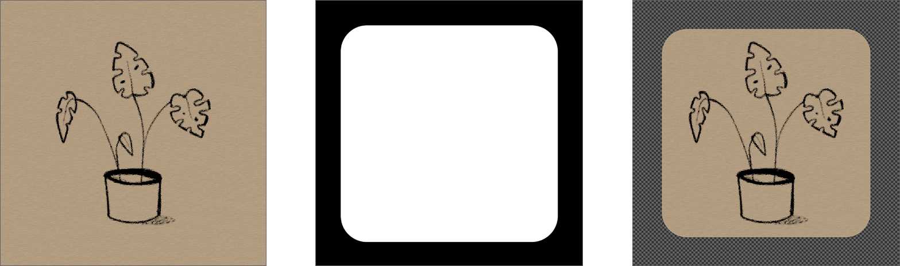

Below you can see how a mask is presented in the layer panel:

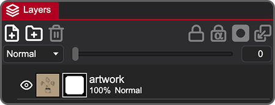

Folders can have masks too, so you can hide parts of everything inside the folder at once.

### Working with Masks

Right clicking on the layer in the layer list opens a menu in which you will find mask related actions:

- `Create Mask` - Adds a **raster** mask. To add a vector mask, you need to use the [node graph](#vector-masks-node-graph).
- `Enable Mask` - Turns the effect of the mask on or off.
- `Apply Mask` - Applies the mask to the layer permanently.
- `Delete Mask` - Removes the mask and shows the layer fully again.

To quickly add a mask, use this icon in the top bar of the layers panel:


### Editing a Mask

Make sure the mask thumbnail is selected if you want to paint on it.

You edit a mask by painting on it with black and white. White shows the layer, black hides it, and shades of gray make the layer partly transparent.

:::note
You can paint on a mask with any color selected, but only the Lightness of that color will be considered (you can see that value in Color Sliders, the HS**L** tab). However, in the mask preview you'll only see shades of gray.
:::

### Vector Masks (Node Graph)

If you want to use a vector shape as a mask, for now you can do that using the Node Graph. 

Prepare the vector mask layer and another layer that you want to mask. Open the Node Graph <span className="pixi-icon icon-nodes"/> located at the top-center of the app and connect the vector layer output to the mask input of the other layer.

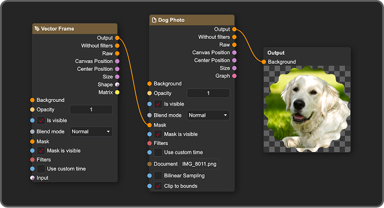

You can now close the Node Graph and modify these two layers as usual.

## Reference Layer

Sometimes you may want to use an external image as a visual guide while working. To add one, click the `Add Reference Layer` button at the bottom of the layers panel and select a PNG or JPG file from your computer.

Unlike standard layers used for drawing, a reference layer is strictly for visual preview and guidance. It is excluded from the actual layer tree, meaning it can't be painted on or edited directly. Because it is purely for preview, it won't interfere with your artwork and maintains high resolution even on small canvases.

The reference image is saved inside your `.pixi` file, so it stays with your project.

Once you select an image, you'll see it on the canvas, and some new elements will appear on the UI:

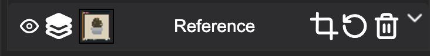

-  <span className="pixi-icon icon-eye"/> / <span className="pixi-icon icon-eye-off"/> - Hides / Shows the reference layer
-  <span className="pixi-icon icon-layers-top"/> / <span className="pixi-icon icon-layers-bottom"/> - Changes the reference layer position to above/under other layers
-  Preview of the reference layer
-  <span className="pixi-icon icon-crop"/> - Enters a transformation mode for the reference layer (scaling and moving the layer)
-  <span className="pixi-icon icon-reset"/> - Resets transformations made to the reference layer
-  <span className="pixi-icon icon-trash"/> - Deletes the current reference layer.

## Layer Shortcuts

By default, many layer actions don't have any shortcut set. If you'd like to add them, go to `Edit → Settings → Key Binding`. To set a new shortcut, click on the input and press any key(s) you want on your keyboard. You can quickly preview all shortcuts by clicking `F1` on the keyboard.

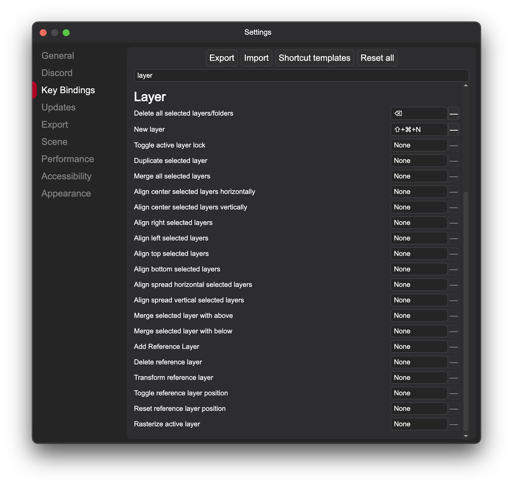
